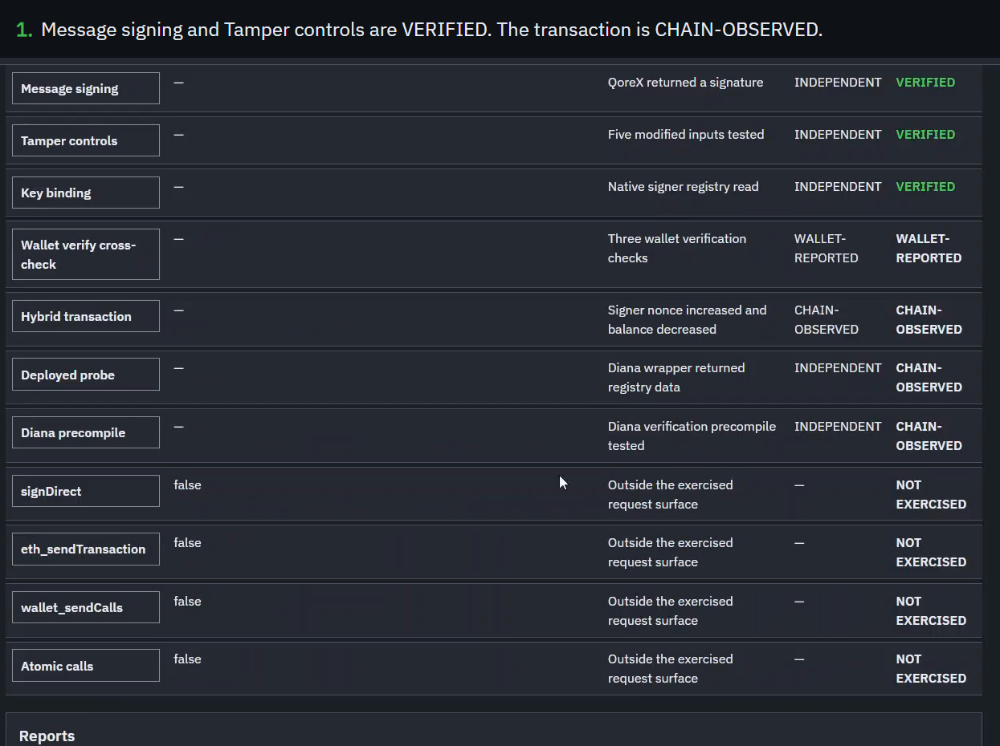
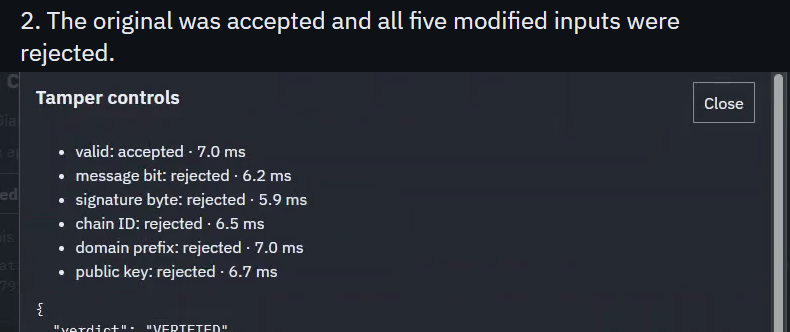
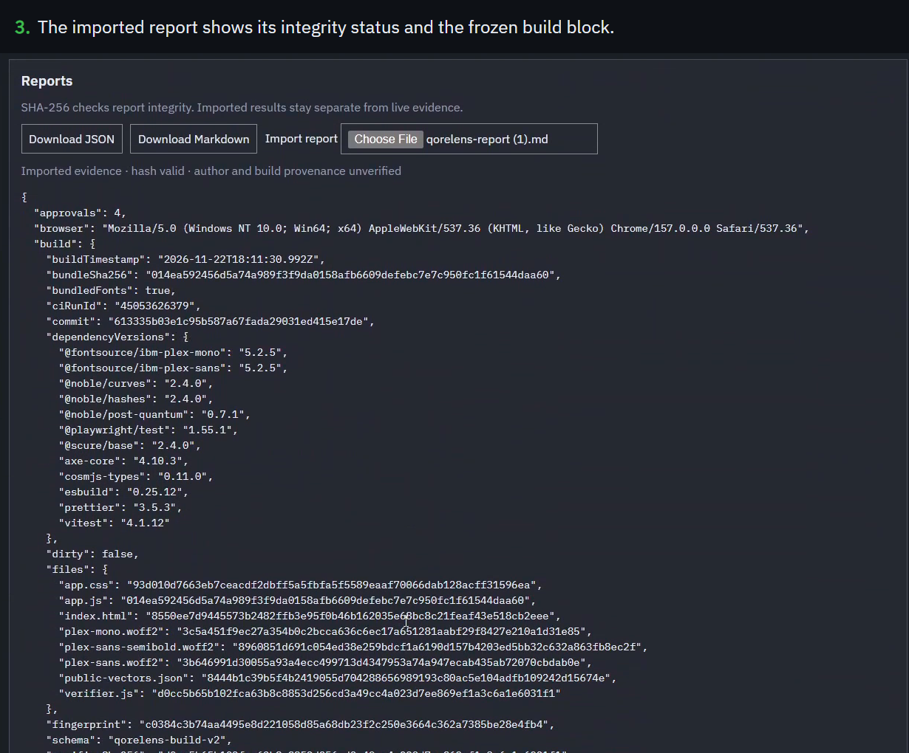
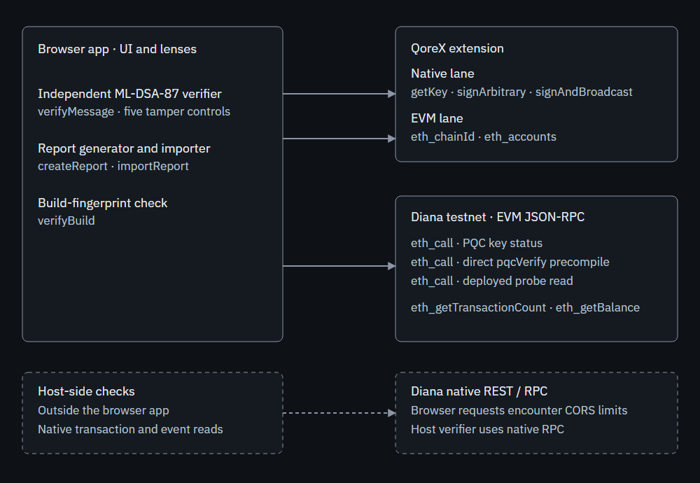

# QoreLens

**Advertised capabilities. Verified behavior.**

Wallets advertise security features, but developers need to know which ones work.

QoreLens checks whether a crypto wallet's security claims are true, and labels every result by how strong the proof is.

[Live app](https://scapexyz.github.io/qorelens/) · [Demo video](https://youtu.be/ipxIkd2eOw8) · [Repository](https://github.com/ScapeXYZ/qorelens) · [Release v1.0.0][release]

**Technical clarification:** Only the message signature is independently verified by QoreLens. The transaction is chain-observed.

A crypto wallet tells you what it can do. QoreLens is a free web page that checks one of those claims by asking the wallet to sign a harmless test message. Its separate checker confirms that the signature is valid for that message and matches the key registered on the QoreChain test network. It deliberately modifies five test inputs and checks that its verifier rejects each one. The report shows which results QoreLens checked itself, which it observed on the blockchain, and which came from the wallet. QoreLens runs in the browser and uses a test network.

The recorded demo report identifies the same frozen v1.0.0 commit and build fingerprint as the live Pages deployment. The saved report and host capture document that match. [Demo report](evidence/video-session.json) · [Live integrity capture](evidence/live-integrity-20261124-015741-452.json)

## Judge quick facts

| Item                       | Evidence                                                                                                                   |
| -------------------------- | -------------------------------------------------------------------------------------------------------------------------- |
| Category                   | Quantum Pass, solo                                                                                                         |
| Network                    | Diana Testnet, native `qorechain-diana`, EVM `9800` (`0x2648`)                                                             |
| License                    | [MIT](LICENSE) and [third-party notices](THIRD_PARTY_NOTICES.md)                                                           |
| Frozen release             | [Commit and fingerprint](#addresses-and-build), [live integrity capture](evidence/live-integrity-20261124-015741-452.json) |
| Probe, signer and deployer | [Addresses and build](#addresses-and-build)                                                                                |
| Demo transaction           | [`5216F3E0…`][video-tx], block 10625585, CHAIN-OBSERVED                                                                    |
| Session A transaction      | [`AD56AC8A…`][rc2-tx], block 10570113, CHAIN-OBSERVED                                                                      |
| Demo and AI usage          | [Video](https://youtu.be/ipxIkd2eOw8) · [AI usage](AI_USAGE.md)                                                            |

## How to test

### Without a wallet, about five minutes

1. Open the [live app](https://scapexyz.github.io/qorelens/). Expect **Build verified · c0384c3b74aa**.
2. Click **Run verifier self-test**. Expect **VERIFIED** for the published cases and their controls.
3. Click **Read deployed probe**. Expect **CHAIN-OBSERVED** if the Diana wrapper returns registry data.
4. Download the recorded demo [JSON][video-json] or [Markdown][video-md]. In **Reports**, choose **Import report**. Expect an integrity match and the recorded build.
5. Compare **Message signing**, **Tamper controls** and **Hybrid transaction** with the screenshots and [verdict legend](#evidence-levels). The [judge guide](JUDGE_TEST.md) includes expected results.

No local server or wallet extension is needed.

Your export is a report of YOUR session. The recorded Session A evidence lives in evidence/; import it with Import report to compare. A verifier-only export shows NOT EXERCISED for wallet rows by design.

### With QoreX, full run

Use desktop Chrome and a throwaway Diana testnet account. Keep seed phrases outside the app. QoreX defaults to QoreChain mainnet. Select Diana Testnet in QoreX before connecting and check the app reports Diana EVM 9800. QoreLens blocks the guided run when the wallet reports another chain, including mainnet EVM 9801. The wallet documentation lists [Diana testnet](https://docs.qorechain.io/qorex/overview/#how-to-access) and describes the [desktop extension](https://docs.qorechain.io/qorex/browser-extension/). [The faucet](https://dashboard.qorechain.io/faucet) requires sign-in. The recorded run used about 0.06 testnet QOR in fees.

Click **Run guided session**. Review the payload of each request. Approve at most six prompts. Inspect the automatic bit-flip rejection in **Message signing**. The only transfer is a 1 uqor self-transfer. Export the report from **Reports** and compare it with the recorded demo.

| Row                           | Expected result on the recorded funded, registered account |
| ----------------------------- | ---------------------------------------------------------- |
| Message signing               | VERIFIED against the chain-read public key                 |
| Tamper controls               | VERIFIED, all five modified inputs rejected                |
| Hybrid transaction            | CHAIN-OBSERVED after the nonce and balance change          |
| Unsupported or unrun features | A non-positive verdict and its reason                      |

## Screenshots

Frame from the live v1.0.0 demo. Message signing and Tamper controls are VERIFIED. The hybrid transaction is CHAIN-OBSERVED.

Frame from the live v1.0.0 demo. The original input is accepted and all five modified inputs are rejected.

Frame from the live v1.0.0 demo showing the imported report and its build block.

## Why QoreChain

QoreLens reads the signer's registered ML-DSA-87 key from Diana, verifies the fixed-message signature against that key, and reads a deployed Solidity probe. Diana accepted the demo transaction. A saved host-side RPC response includes the chain-reported hybrid verification event.

## How it works

[Architecture and source mapping](docs/ARCHITECTURE.md) · [Testing and reproduction](docs/TESTING.md)

## Evidence levels

| Label           | Meaning                                                                                                                              |
| --------------- | ------------------------------------------------------------------------------------------------------------------------------------ |
| VERIFIED        | QoreLens checked the fixed-message signature independently against the chain-read key. The five modified inputs failed verification. |
| CHAIN-OBSERVED  | The chain returned data or state changed as expected. The transaction signature bytes were not independently inspected.              |
| WALLET-REPORTED | The wallet returned the result.                                                                                                      |

### Report digest and build record

| Field            | What it records                                                                                 |
| ---------------- | ----------------------------------------------------------------------------------------------- |
| Integrity digest | SHA-256 over the canonical report contents, excluding the integrity field.                      |
| Authorship       | The digest alone cannot establish who produced the report or whether its observations are true. |
| Build block      | Provenance for the producing build. The in-page check compares the assets with the manifest.    |

## Quantum Pass requirements and evidence

| Requirement        | Evidence                                                                                                                                                                                      |
| ------------------ | --------------------------------------------------------------------------------------------------------------------------------------------------------------------------------------------- |
| Scaffold           | The `create-qorechain-dapp@0.12.0` Foundry template supplied the helper used for the probe deployment. The browser app in `src/` is project-written. [Origin audit](evidence/origin-audit.md) |
| QoreX connection   | The [demo report](evidence/video-session.json) records the real QoreX v0.4.3 connection, network and account reads.                                                                           |
| Testnet deployment | [Solidity probe deployment][probe], [Pages CI][ci] and [eight asset hashes](evidence/live-integrity-20261124-015741-452.json).                                                                |
| Message signing    | **VERIFIED** fixed-message ML-DSA-87 signature and five rejected modified inputs. [Demo report](evidence/video-session.json)                                                                  |
| Hybrid transaction | **CHAIN-OBSERVED**, [block and event evidence](evidence/video-session-rpc-verification.json). Hybrid signing is inferred from the chain event.                                                |
| PQC key registry   | [Solidity probe source](contracts/QoreLensProbe.sol#L12-L21), and the deployed probe read in the [demo report](evidence/video-session.json).                                                  |

## Reproduce the checks

Use the [live fingerprint][fingerprint], [testing instructions](docs/TESTING.md), and explorer links for the [demo][video-tx], [Session A][rc2-tx], and [probe][probe]. The [manifest](evidence/acceptance-manifest.json) and [machine-readable deployments](evidence/deployments.testnet.json) link provenance and results.

## Run locally

The wallet-free route uses Pages. For developers, see the [developer commands](docs/TESTING.md#developer-commands) taken from `package.json`.

## Limitations

The Advertised column is sparse because many rows display runtime evidence only. Best viewed at desktop widths (1024 px or more). On narrower screens the matrix scrolls horizontally and the Verdict column may need scrolling.

- Testnet only. The recorded behavior is tied to QoreX v0.4.3.
- The native and EVM addresses in Session A are `DISTINCT_BY_DERIVATION`.
  The native lane did not expose a chain query in that session.
- `signArbitrary` did not return a PQ public key. Verification used the
  registry key. Transaction signature bytes and preimages were not independently
  inspected.
- The app relies on a single public Diana EVM RPC. Browser requests to native
  REST and consensus RPC failed in the recorded CORS checks. Native event and
  fee confirmation used host-side RPC.
- The rc2 transaction is **CHAIN-OBSERVED**. Diana reported a verified PQC event.
  Hybrid signing is inferred from chain-reported evidence. The explorer's
  `0.06 QOR` display matches the `60,000 uqor` fee, while the message sent
  `1 uqor` from the native signer to itself.
- rc1 sessions are **superseded, historical**. Phase 0 evidence is **historical,
  replayed**. The [approved Phase 0 limitation](docs/PHASE_0_ACCEPTANCE.md)
  preserves the original wording.

## Addresses and build

| Item                    | Recorded value                               |
| ----------------------- | -------------------------------------------- |
| Diana probe             | `0x05d2c199925e43767b79a6564542de75fa03f0c5` |
| Probe deployer, EVM     | `0x2ed58f9428D1A07F70AEF3BF5114330F15934b89` |
| Probe deployer, native  | `qor19m2cl9pg6xs87u9w7wl4z9pnpu2exjufzzxhhj` |
| Session A native signer | `qor1ylgewp0h038mrnslyte4yst20q0zwdhqs7fujv` |
| Frozen Pages commit     | `613335b03e1c`                               |
| Build fingerprint       | `c0384c3b74aa`                               |
| Bundle SHA-256          | `014ea592456d`                               |
| Pages CI run            | [45053626379][ci]                            |

## Evidence manifest

See the [acceptance manifest](evidence/acceptance-manifest.json),
[AI usage](AI_USAGE.md), [Contributing](CONTRIBUTING.md), and
[post-hackathon backlog](docs/POST_HACKATHON.md).

## Acknowledgements and licenses

See [third-party notices](THIRD_PARTY_NOTICES.md) for package versions, licenses, fonts, and QoreSign vectors. The rejected UI candidate is outside this submission.

## AI usage

[Contributor roles and evidence provenance](AI_USAGE.md).

## License

[MIT](LICENSE).

[ci]: https://github.com/ScapeXYZ/qorelens/actions/runs/45053626379
[fingerprint]: https://scapexyz.github.io/qorelens/fingerprint.json
[release]: https://github.com/ScapeXYZ/qorelens/tree/v1.0.0
[probe]: https://dashboard.qorechain.io/explorer/tx/0x54029f6dca0b82dbde7a5de5325c5ca9bc88914d46cb17276e6ffdefd58ae36a
[rc1-tx]: https://dashboard.qorechain.io/explorer/tx/B839B613A4A1A386730C5B279B41C954C40E81EFB53C9371498EB622C9AB2C91
[rc2-tx]: https://dashboard.qorechain.io/explorer/tx/AD56AC8AEAC810C7393C96AD9CD31C55DDDC7ECD3C9C7F96BF6F03D653956E0A
[video-tx]: https://dashboard.qorechain.io/explorer/tx/5216F3E05807BDEBD8E843E831635FE60316D294FE94DE03690F3C5D520D8DDE
[video-json]: https://github.com/ScapeXYZ/qorelens/raw/master/evidence/video-session.json
[video-md]: https://github.com/ScapeXYZ/qorelens/raw/master/evidence/video-session.md
