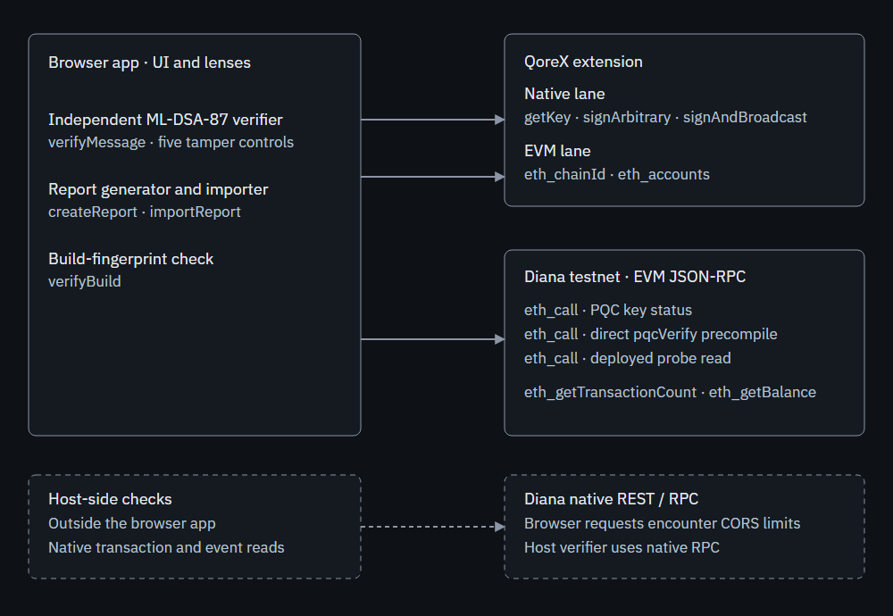
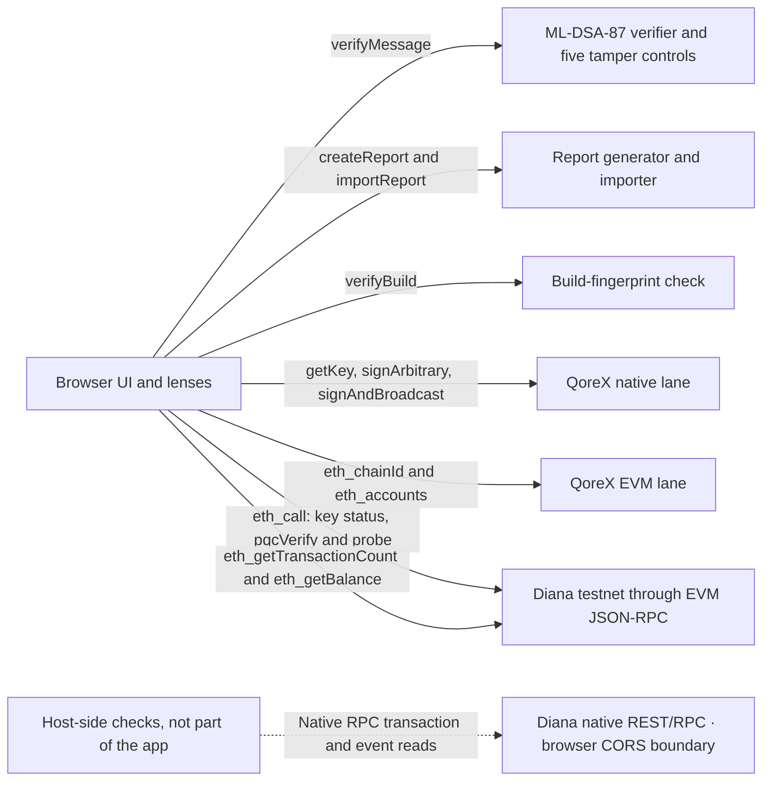

# Architecture

The browser runs the app, verifier and report tools. The native QoreX lane signs and broadcasts. Its EVM lane supplies account and network information. A separate Diana JSON-RPC endpoint provides chain reads.

Native REST and consensus RPC are blocked by CORS in browsers in the recorded run. The host uses the separate native RPC endpoint for transaction and event reads. The archived verification uses native RPC for inclusion and events and EVM JSON-RPC for historical nonce and balance.

[Implementation and evidence mapping](../evidence/diagram-mapping.md).
